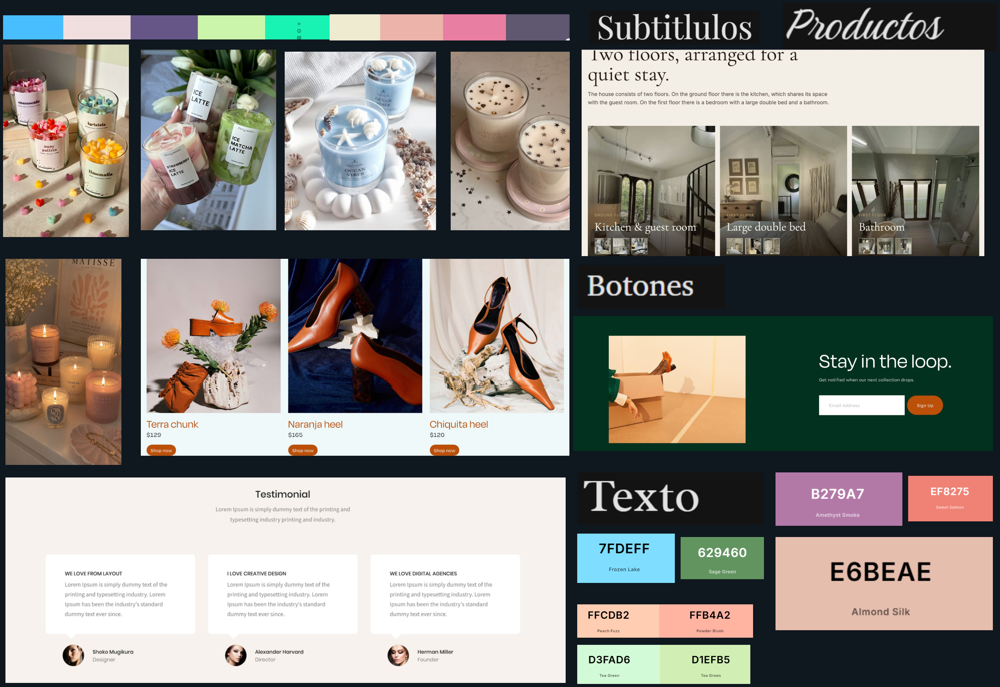

# Moodboard — LUMÉ

> Guía: [Moodboard](../evaluacion/guias/fase-2-specs/02-moodboard.md)

**Tablero en Whimsical:** https://whimsical.com/rhode4/RHgv9oVdn7gR6iA9tPX1Yz

## Palabras clave 

Estético · Minimalista · Confort · Artesanal · Aromaterapia

## Qué sensación buscamos

Buscamos transmitir una sensación de refugio cálido, pausa y calma estética al final del día, transformando el espacio personal en un rincón acogedor mediante la luz tenue y fragancias reconfortantes como un matcha latte o notas marinas; esto conecta de inmediato con Catalina porque atiende directamente su necesidad de tranquilidad tras estudiar o trabajar, al mismo tiempo que satisface su motivación por decorar su habitación con piezas de estética *aesthetic* y colores pastel que resultan sumamente atractivas para su hábito de comprar por Instagram y tiendas online.
