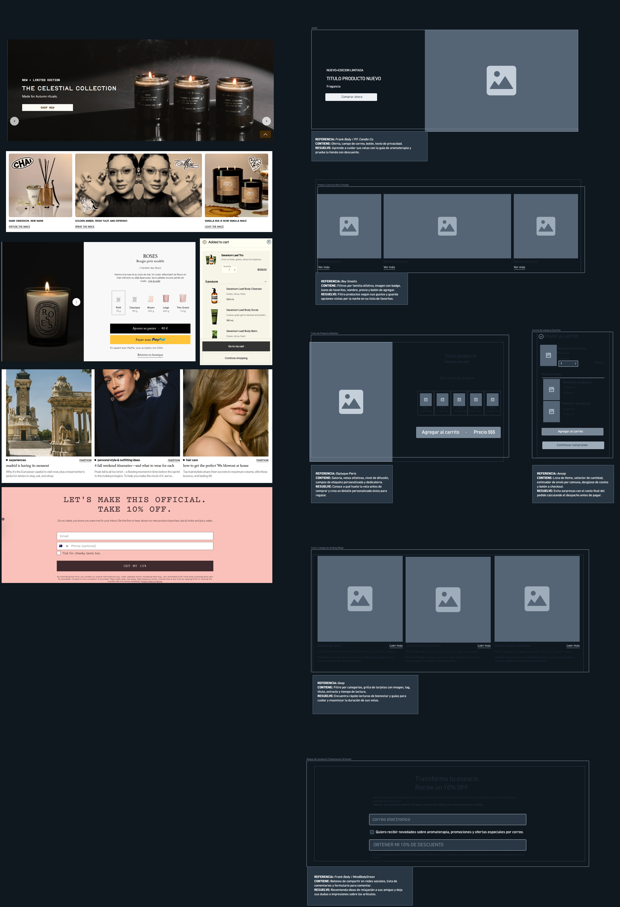

# Componentes — LUMÉ

> Guía: [Componentes](../evaluacion/guias/fase-2-specs/03-calco-de-componentes.md)

**Tablero en Whimsical:** https://whimsical.com/rhode4/MTysZiEknZu1kHmAtXp7wo

## Tabla de Componentes Calcados

| Componente | Referencia | Qué contiene | Qué necesidad resuelve |
|---|---|---|---|
| **Hero & Banner de Captación** | *P.F. Candle Co.* | • Titular principal (H1) con propuesta de valor. • Subtítulo y CTA hacia la Tienda. • Imagen/video de fondo en ambiente cálido. • Formulario integrado: Input de Email + Botón de suscripción. | Permite a Catalina conocer de inmediato la propuesta artesanal de LUMÉ y dejar su correo para obtener el 10% de descuento en su primera compra y la guía de aromaterapia. |
| **Product Card con Filtro Sensorial** | *Boy Smells* | • Grid de catálogo de productos. • Imagen principal con efecto hover y Badge ("Nuevo"). • Icono de Favoritos (corazón). • Título, familia olfativa (ej: Floral) y precio. • Botón rápido "Agregar al carrito". | Permite a Catalina buscar y filtrar productos rápidamente por familia olfativa, precio y guardar opciones vistas por la noche en su lista de favoritos. |
| **Ficha de Pirámide Olfativa y Personalización** | *Diptyque Paris* | • Galería de imágenes y detalle de producto. • Puntuación con estrellas y reseñas. • Desglose visual de notas olfativas (Salida, Corazón y Fondo) e intensidad de difusión. • Campos configurables para personalizar la etiqueta y agregar dedicatoria de regalo. | Permite a Catalina saber a qué huele la vela antes de comprar (composición aromática) y crear un detalle especial y único para regalar. |
| **Carrito de Compras con Estimador** | *Aesop* | • Lista de artículos agregados con foto y dedicatoria elegida. • Controles de cantidad (+/-) y botón de eliminar. • Input para ingresar comuna / código postal con cálculo automático de despacho. • Resumen: Subtotal, envío estimado y Total. • Botón destacado hacia el Checkout. | Evita sorpresas con el costo final del pedido al permitirle a Catalina calcular el costo de despacho y la fecha estimada de entrega ingresando su comuna. |
| **Tarjetas de Blog y Categorías** | *Goop* | • Menú superior de categorías (*Aromaterapia*, *Cuidado de Velas*, *Decoración*). • Tarjetas de artículo (*Cards*): Foto destacada, tag de categoría, título, extracto y tiempo de lectura. • Barra de búsqueda integrada en el blog. | Permite a Catalina navegar las lecturas de su interés sobre bienestar por categoría y consultar guías para maximizar la duración y encendido seguro de sus velas. |
| **Bloque de Compartir y Comentarios** | *Frank Body* | • Botones de acción rápida para compartir en redes sociales (WhatsApp e Instagram). • Sección de comentarios: Lista de mensajes publicados de otros lectores. • Formulario para comentar (Campos: Nombre, Correo, Mensaje y Botón Enviar). | Permite a Catalina recomendar ideas de relajación a sus amigas compartiendo el artículo, y escribir sus propias dudas o impresiones sobre los contenidos. |

---

## Detalle de Componentes Calcados

### 1. Banner / Pop-up de Captación de Leads (Landing)
* **De dónde se sacó (Referencia):** *P.F. Candle Co.* / *Frank Body*
* **Qué contiene:**
  * Titular principal (H1) con propuesta de valor y beneficio (*"Transforma tu espacio. Recibe un 10% OFF"*).
  * Texto explicativo de la oferta y beneficio de la guía digital.
  * Campo de entrada de texto (*Input*) para el correo electrónico.
  * Casilla de verificación (*Checkbox*) de aceptación de términos/suscripción.
  * Botón principal de llamada a la acción (*CTA*): *"OBTENER MI 10% DE DESCUENTO"*.
* **Qué necesidad de Catalina resuelve:**
  * **Objetivo de Catalina:** Obtener un beneficio y conocer novedades sobre aromaterapia.
  * **Solución:** Le permite dejar su correo electrónico de forma rápida a cambio de un **10% de descuento en su primera compra** y la **guía digital de aromaterapia para el hogar**.

---

### 2. Product Card con Filtro Sensorial (Tienda / Catálogo)
* **De dónde se sacó (Referencia):** *Boy Smells* (`boysmells.com`)
* **Qué contiene:**
  * Cuadrícula (*Grid*) de productos de la tienda.
  * Contenedor de imagen (*Placeholder*) con distintivo (*Badge*) de "Nuevo" o "Más vendido".
  * Ícono interactivo de **Favoritos** (corazón).
  * Título de la vela, familia olfativa (ej: *Floral y Fresca*) y precio.
  * Botón directo de compra/agregar rápido *"Agregar al carrito"*.
* **Qué necesidad de Catalina resuelve:**
  * **Objetivo de Catalina:** Explorar velas según sus preferencias/presupuesto y guardar opciones vistas por la noche.
  * **Solución:** Le permite filtrar y explorar productos por familia olfativa y rango de precio rápidamente, ofreciéndole además la opción de marcar velas con el ícono de corazón para guardarlas en su **lista de favoritos** y revisarlas en otra sesión.

---

### 3. Ficha de Pirámide Olfativa y Personalización (Tienda / Producto)
* **De dónde se sacó (Referencia):** *Diptyque Paris* (`diptyqueparis.com`)
* **Qué contiene:**
  * Galería de imágenes e imagen principal del producto.
  * Puntuación media en estrellas y resumen de reseñas.
  * **Bloque de Pirámide Olfativa:** Desglose visual de notas de Salida, Corazón y Fondo.
  * Indicador gráfico de **Intensidad de Difusión** (suave, media, intensa).
  * Módulo de personalización: Selector de tipo de envase, campo de texto para el mensaje de la etiqueta y campo para dedicatoria de regalo.
  * Selector de cantidad y botón *"Agregar al carrito"*.
* **Qué necesidad de Catalina resuelve:**
  * **Objetivo de Catalina:** Saber a qué huele la vela antes de comprar y crear un detalle especial para regalar.
  * **Solución:** Muestra la composición aromática detallada y la difusión para tomar una decisión informada sin oler el producto físico, además de permitirle personalizar el mensaje de la etiqueta y agregar una dedicatoria única.

---

### 4. Carrito de Compras con Estimador de Despacho (Tienda / Carrito)
* **De dónde se sacó (Referencia):** *Aesop* (`aesop.com`)
* **Qué contiene:**
  * Lista de ítems agregados con miniatura, variante (tamaño/aroma) y dedicatoria guardada.
  * Controles de cantidad (`+` / `-`) y botón para eliminar producto.
  * **Módulo Estimador de Despacho:** Campo de entrada para ingresar la comuna o código postal y botón *"Calcular envío"*.
  * Resumen financiero: Subtotal, Costo de envío estimado y Total final.
  * Botón principal *"Ir a Checkout"*.
* **Qué necesidad de Catalina resuelve:**
  * **Objetivo de Catalina:** Evitar sorpresas con el costo final del pedido antes de pagar.
  * **Solución:** Le permite calcular de forma transparente el costo de envío y conocer la fecha estimada de entrega ingresando únicamente su comuna antes de avanzar al checkout.

---

### 5. Tarjetas de Blog y Filtro de Categorías (Blog)
* **De dónde se sacó (Referencia):** *Goop* (`goop.com/editorial`)
* **Qué contiene:**
  * Menú de pestañas/filtros por categorías (*Aromaterapia y Bienestar*, *Cuidado de Velas*, *Decoración e Inspiración*, *Regalos*).
  * Barra de búsqueda dentro del blog.
  * Grilla de tarjetas de artículo (*Cards*) compuestas por:
    * Imagen destacada (*Placeholder*).
    * Etiqueta de categoría (*Tag*).
    * Título del artículo (ej: *"El secreto del recorte de mecha"*).
    * Extracto o resumen corto.
    * Tiempo estimado de lectura.
* **Qué necesidad de Catalina resuelve:**
  * **Objetivo de Catalina:** Encontrar lecturas de su interés sobre bienestar y maximizar la duración/seguridad de sus velas.
  * **Solución:** Facilita la navegación organizada por temas para acceder rápidamente a consejos de cuidado de velas, guías de encendido seguro y contenidos sobre uso de fragancias para el hogar.

---

### 6. Bloque de Compartir e Interacción (Blog / Artículo)
* **De dónde se sacó (Referencia):** *Frank Body* / *MindBodyGreen*
* **Qué contiene:**
  * Botones directos para compartir en redes sociales (**WhatsApp** e **Instagram**).
  * Sección de comentarios publicados de otros lectores (con nombre, fecha y mensaje).
  * Formulario para publicar comentario: Campos para *Nombre*, *Email*, *Comentario* y botón *"Enviar comentario"*.
* **Qué necesidad de Catalina resuelve:**
  * **Objetivo de Catalina:** Recomendar ideas de relajación a sus amigas y compartir sus dudas/impresiones sobre un artículo.
  * **Solución:** Le proporciona accesos directos en un solo clic para compartir artículos por WhatsApp/Instagram y le da una vía interactiva para dejar sus preguntas o impresiones sobre los cuidados y aromas al final del post.
