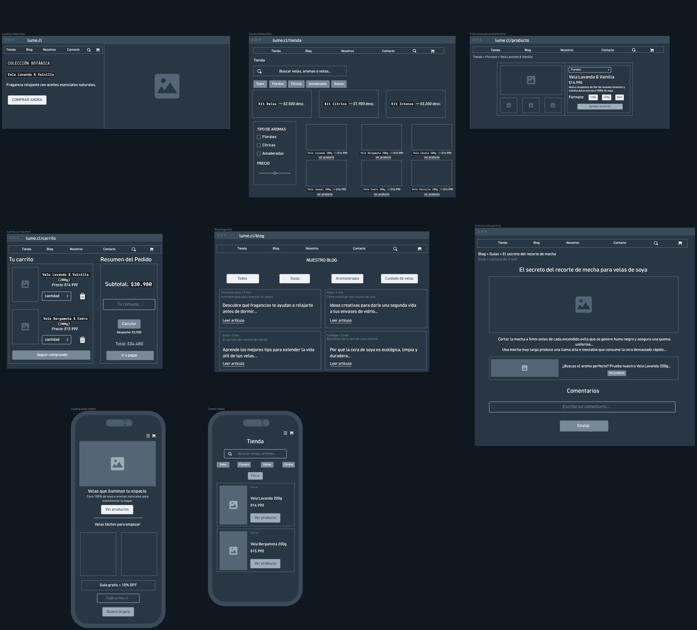

# Spec de diseño — LUMÉ

> Guía: [Spec de diseño](../evaluacion/guias/fase-2-specs/06-spec-de-diseno.md)

La spec de diseño tiene dos partes:

1. **[`DESIGN.md`](../DESIGN.md)** (en la raíz): tu design system, en el formato que Stitch importa.
2. **Este documento:** tus pantallas, escritas como prompts listos para pegar en Stitch.

**Wireframes en Whimsical:** https://whimsical.com/rhode4/wireframes-lume-LniPRnsrisy1VTvvBWfHv5

> Guía de wireframes: [Wireframes](../evaluacion/guias/fase-2-specs/04-wireframes.md)


## Pantallas

<!-- Un prompt por pantalla. Cada uno con: pantalla y dispositivo, objetivo
de tu proto-persona, componentes de arriba hacia abajo (con los nombres de
tu DESIGN.md) y textos y datos reales. -->

### 1. Landing

```text
Pantalla: Landing de LUMÉ, versión desktop. Usa el design system del proyecto.
Objetivo: que Catalina descubra la propuesta artesanal de calma y bienestar de LUMÉ, explore la colección botánica y obtenga el 10% de descuento con la guía de aromaterapia para ambientar y decorar su habitación.
Componentes, de arriba hacia abajo:
1. Navbar: logo "LUMÉ" (enlace a inicio), enlaces de navegación "Tienda", "Blog", "Nosotros", "Contacto", ícono de búsqueda e ícono de carrito de compras con contador de artículos.
2. hero-banner: contenedor a dos columnas con fondo secondary y bordes rounded.lg.
   - Columna izquierda: tag-category con texto "COLECCIÓN BOTÁNICA", titular h1 en headline-display "Vela Lavanda & Vainilla", bajada en body-md "Fragancia relajante con aceites esenciales naturales." y botón button-primary con texto "COMPRAR AHORA".
   - Columna derecha: fotografía editorial destacada de la vela de soja en frasco de vidrio ámbar sobre lino claro, iluminada por luz natural tenue de atardecer.
3. Sección destacada "Velas que iluminan tu espacio": titular h2 en headline-lg, subtítulo en body-md "Cera 100% de soya y aromas naturales para transformar tu hogar", y grilla de tarjetas card-product ("Velas fáciles para empezar"):
   - card-product 1: imagen de vela, tag-category "Floral", título "Vela Lavanda 200g", precio "$14.990", botón button-secondary "Ver producto".
   - card-product 2: imagen de vela, tag-category "Cítrica", título "Vela Bergamota 200g", precio "$15.990", botón button-secondary "Ver producto".
4. Módulo de captación de leads: contenedor con fondo surface-warm y bordes rounded.lg con titular h2 en headline-md "Guía gratis + 10% OFF", bajada en body-md "Suscríbete para recibir un 10% de descuento en tu primera compra y nuestra guía digital de aromaterapia para el hogar", campo input-field con placeholder "Tu@correo.cl" y botón button-accent con texto "Quiero la guía".
5. Footer: fondo primary con texto on-primary, enlaces a "Políticas de envío", "Términos y condiciones", redes sociales (Instagram @lume.velas, WhatsApp), contacto "contacto@lume.cl" y sello artesanal "Hecho a mano en Chile · Cera 100% de soja natural".
```

### 2. Tienda

```text
Pantalla: Tienda de LUMÉ, versión desktop. Usa el design system del proyecto.
Objetivo: que Catalina explore el catálogo de velas aromáticas, filtre por familia olfativa y presupuesto, aproveche kits con descuento y encuentre rápido la fragancia ideal para desconectarse.
Componentes, de arriba hacia abajo:
1. Navbar: logo "LUMÉ", enlaces "Tienda" (activo), "Blog", "Nosotros", "Contacto", ícono de búsqueda e ícono de carrito de compras.
2. Encabezado de catálogo: titular h1 en headline-lg "Tienda" y barra de búsqueda interactiva con input-field con ícono de lupa y placeholder "Buscar velas, aromas o notas...".
3. Chips de categoría: fila horizontal de tag-category con opciones "Todos" (activo con estilo primario), "Florales", "Cítricos", "Amaderados", "Dulces".
4. Fila promocional de kits: 3 tarjetas horizontales con fondo secondary, bordes rounded.md y tag-offer de descuento:
   - Kit Relax — $2.500 desc.
   - Kit Cítrico — $1.900 desc.
   - Kit Intenso — $3.200 desc.
5. Layout principal a 2 columnas (Filtros laterales + Grilla de productos):
   - A la izquierda, barra lateral fija de filtros con fondo neutral:
     - Título "TIPO DE AROMAS" en label-md con checkboxes: "[ ] Florales", "[ ] Cítricas", "[ ] Amaderadas".
     - Título "PRECIO" en label-md con slider interactivo de rango de precio ($10.000 - $35.000).
   - A la derecha, grilla de 3 columnas con 6 tarjetas card-product (cada una con foto cuadrada rounded.md, ícono de favoritos de corazón, familia olfativa en label-sm, nombre en title-md, precio en label-md y botón button-secondary "ver producto"):
     1. card-product: Vela Lavanda 200g — $14.990 (Floral).
     2. card-product: Vela Bergamota 200g — $15.990 (Cítrica).
     3. card-product: Vela Canela 200g — $14.990 (Dulce).
     4. card-product: Vela Jazmín 200g — $16.990 (Floral).
     5. card-product: Vela Cedro 200g — $15.990 (Amaderada).
     6. card-product: Vela Vainilla 200g — $14.990 (Dulce).
6. Footer: fondo primary con enlaces de servicio, medios de pago y sello de sustentabilidad.
```

### 3. Ficha de producto

```text
Pantalla: Ficha de producto de LUMÉ, versión desktop. Usa el design system del proyecto.
Objetivo: que Catalina conozca en detalle la fragancia, notas olfativas de salida, corazón y fondo, opciones de formato y cuidados de la vela para comprar con total seguridad y confianza.
Componentes, de arriba hacia abajo:
1. Navbar: logo "LUMÉ", enlaces "Tienda", "Blog", "Nosotros", "Contacto", ícono de búsqueda e ícono de carrito.
2. Migas de pan (breadcrumbs) en body-sm: "Tienda > Florales > Vela Lavanda & Vainilla".
3. Módulo principal de producto a 2 columnas:
   - Columna izquierda (Galería):
     - Contenedor de fotografía principal en proporción 4:5 con esquinas rounded.md, mostrando la Vela Lavanda & Vainilla encendida en ambiente cálido de relajación.
     - Fila inferior con 3 miniaturas de fotografía (thumbnails con bordes rounded.md y borde activo en primary: detalle de la mecha de algodón, etiqueta botánica y envase de vidrio ámbar).
   - Columna derecha (Información y compra):
     - Chip desplegable de categoría tag-category: "Florales".
     - Titular h1 en headline-lg: "Vela Lavanda & Vainilla".
     - Precio en headline-md: "$14.990".
     - Descripción sensorial en body-md: "Notas relajantes de flor de lavanda silvestre y vainilla dulce con cera 100% de soya."
     - Bloque de pirámide olfativa (en contenedor surface-warm con esquinas rounded.md): desglose visual de notas de salida (Lavanda silvestre), corazón (Flores blancas y manzanilla) y fondo (Vainilla dulce cálida), junto con indicador de intensidad de difusión (Media).
     - Selector de formato con botones en píldora: "100g", "200g" (activo) y "Melt".
     - Botón primario de acción button-primary: "Agregar al carrito".
4. Footer: fondo primary con información de envíos y garantías.
```

### 4. Carrito

```text
Pantalla: Carrito de LUMÉ, versión desktop. Usa el design system del proyecto.
Objetivo: que Catalina revise los productos agregados, ajuste cantidades, calcule el despacho ingresando su comuna y complete la compra sin trámites largos ni cuentas obligatorias.
Componentes, de arriba hacia abajo:
1. Navbar: logo "LUMÉ", enlaces de navegación, buscador e ícono de carrito de compras con contador "2".
2. Layout principal a 2 columnas (Artículos + Resumen de compra):
   - Columna izquierda ("Tu carrito"):
     - Titular h1 en headline-md: "Tu carrito".
     - Tarjeta de ítem 1: miniatura de fotografía con esquinas rounded.md, título en title-md "Vela Lavanda & Vainilla (200g)", precio en body-md "Precio: $14.990", selector de cantidad numérico "cantidad: 1" con botones +/- e ícono de papelera para eliminar.
     - Tarjeta de ítem 2: miniatura de fotografía con esquinas rounded.md, título en title-md "Vela Bergamota & Cedro (200g)", precio en body-md "Precio: $15.990", selector de cantidad numérico "cantidad: 1" con botones +/- e ícono de papelera para eliminar.
     - Botón secundario button-secondary con texto "Seguir comprando".
   - Columna derecha (cart-summary "Resumen del Pedido"):
     - Tarjeta contenedora blanca surface con bordes rounded.md, padding spacing.lg y elevación suave:
       - Título de sección en title-md: "Resumen del Pedido".
       - Fila de subtotal en body-md: "Subtotal: $30.980".
       - Módulo estimador de despacho: campo input-field con placeholder "Tu comuna..." y botón button-secondary "Calcular".
       - Fila de despacho en body-md: "Despacho: $3.500".
       - Línea divisoria y total destacado en headline-md: "Total: $34.480".
       - Botón primario button-primary con texto "Ir a pagar".
3. Footer: fondo primary con medios de pago seguros y sellos de garantía.
```

### 5. Blog

```text
Pantalla: Blog de LUMÉ, versión desktop. Usa el design system del proyecto.
Objetivo: que Catalina explore lecturas sobre aromaterapia, rituales de bienestar y consejos para alargar la vida útil de sus velas artesanales.
Componentes, de arriba hacia abajo:
1. Navbar: logo "LUMÉ", enlaces con "Blog" activo, ícono de búsqueda e ícono de carrito.
2. Encabezado principal: titular h1 centrado en headline-display "NUESTRO BLOG" y bajada en body-md "Rituales de bienestar, aromaterapia y guías para crear un refugio de calma".
3. Chips de categoría: fila horizontal de tag-category con opciones "Todos" (activo con estilo primario), "Guías", "Aromaterapia", "Cuidado de velas".
4. Grilla de artículos en 2 columnas con 4 tarjetas card-blog (cada una con imagen 16:9 con esquinas rounded.md, tag de categoría y tiempo en label-sm, subtítulo temático, título en title-md, extracto en body-sm y enlace "Leer artículo"):
   - card-blog 1: metadatos "Aromaterapia • 5 min", subtítulo "Aromaterapia para conciliar el sueño", título "Descubre qué fragancias te ayudan a relajarte antes de dormir...", extracto sobre cómo la lavanda facilita el sueño y enlace "Leer artículo".
   - card-blog 2: metadatos "Guía • 4 min", subtítulo "Cómo reutilizar tus frascos de vela", título "Ideas creativas para darle una segunda vida a tus envases de vidrio...", extracto sobre limpieza fácil de cera de soya y reutilización decorativa, y enlace "Leer artículo".
   - card-blog 3: metadatos "Guía • 3 min", subtítulo "El secreto del recorte de mecha", título "Aprende los mejores tips para extender la vida útil de tus velas...", extracto sobre la técnica de mecha a 5 mm para una combustión limpia, y enlace "Leer artículo".
   - card-blog 4: metadatos "Cuidado • 3 min", subtítulo "Beneficios de la cera de soya natural", título "Por qué la cera de soya es ecológica, limpia y duradera...", extracto sobre cera vegetal no tóxica y sostenible, y enlace "Leer artículo".
5. Footer: fondo primary con suscripción al boletín de bienestar y enlaces de navegación.
```

### 6. Artículo

```text
Pantalla: Artículo del blog de LUMÉ, versión desktop. Usa el design system del proyecto.
Objetivo: que Catalina aprenda tips prácticos para mantener sus velas en óptimas condiciones, descubra productos recomendados para su hogar y participe dejando comentarios.
Componentes, de arriba hacia abajo:
1. Navbar: logo "LUMÉ", navegación con "Blog" activo, búsqueda y carrito.
2. Migas de pan (breadcrumbs) en body-sm: "Blog > Guías > El secreto del recorte de mecha".
3. Metadatos en label-sm: "Guía • Lectura de 3 min".
4. Titular h1 centrado en headline-display: "El secreto del recorte de mecha para velas de soya".
5. Fotografía principal destacada en proporción panorámica 16:9 con esquinas rounded.md, mostrando una vela de soya encendida junto a tijeras despabiladoras y fósforos artesanales.
6. Cuerpo editorial en body-md (ancho de lectura 750px centrado, lineHeight 1.6):
   - Párrafo 1: "Cortar la mecha a 5mm antes de cada encendido evita que se genere humo negro y asegura una quema uniforme..."
   - Párrafo 2: "Una mecha muy larga produce una llama alta e inestable que consume la cera demasiado rápido y puede provocar manchas en el vidrio..."
   - Párrafo 3: Consejos prácticos sobre permitir que la primera quema alcance los bordes del frasco (mínimo 2 horas) y apagar siempre sin soplar.
7. Tarjeta de producto relacionado integrada en el artículo (card horizontal con fondo surface-warm y esquinas rounded.md):
   - Miniatura de fotografía de producto a la izquierda.
   - A la derecha: texto en body-md "¿Buscas el aroma perfecto? Prueba nuestra Vela Lavanda 200g elaborada con mecha 100% de algodón" y botón button-secondary "Ver producto".
8. Bloque para compartir: botones en píldora para compartir en "WhatsApp" y "Instagram".
9. Módulo interactivo de comentarios:
   - Titular h3 en headline-md: "Comentarios".
   - Formulario para comentar: campo multilínea input-field con placeholder "Escribe un comentario..." y botón button-primary "Enviar".
10. Footer: fondo primary con enlaces institucionales y redes sociales.
```

### Versión mobile (para cada pantalla)

```text
Genera la versión mobile (375px de ancho) de esta pantalla siguiendo la sección Layout del design system:
- Viewport de 375px de ancho con márgenes laterales de 16px (spacing.md) y espaciado vertical entre secciones de 32px (spacing.xl).
- Navbar condensado: logotipo "LUMÉ" a la izquierda, ícono de carrito de compras e ícono de menú hamburguesa a la derecha que despliega un drawer lateral de navegación.
- Landing: apila el hero-banner verticalmente (fotografía arriba, texto y botón button-primary "Ver productos" debajo); presenta la sección "Velas fáciles para empezar" en grilla compacta de 2 columnas o 1 columna de tarjetas card-product; módulo de captación "Guía gratis + 10% OFF" apilado con input-field y botón button-accent al 100% del ancho.
- Tienda: barra de búsqueda input-field a ancho completo, chips de categoría tag-category con scroll horizontal deslizable, botón button-secondary "Filtrar" que abre un drawer inferior con checkboxes de aromas y control de precio, y catálogo en 1 columna de tarjetas card-product apiladas verticalmente con botón de compra rápida.
- Ficha de producto: galería de imágenes en carrusel horizontal con swipe táctil, desglose de pirámide olfativa y selectores de formato apilados, y botón button-primary "Agregar al carrito" en barra inferior fija (sticky) de fácil alcance para el pulgar.
- Carrito: lista de productos apilada verticalmente con selectores táctiles (+ / - y papelera), seguida de la tarjeta cart-summary apilada abajo con estimador de comuna y botón button-primary "Ir a pagar" a ancho completo.
- Blog y Artículo: tarjetas card-blog apiladas en 1 columna a ancho completo; lectura de artículo ajustada a 100% con márgenes de 16px, tarjeta de producto recomendado apilada y formulario de comentarios con botón button-primary a ancho completo.
- Todos los botones y campos interactivos mantienen un ancho de 100% y una altura táctil mínima de 44px para facilitar la pulsación en pantallas móviles.
```
