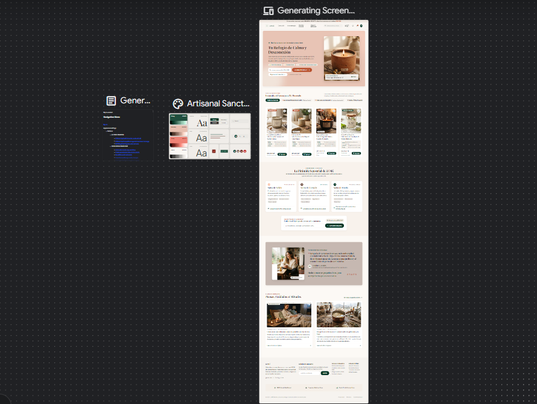

# QA — LUMÉ

> Guía: [QA y coherencia](../evaluacion/guias/fase-3-prototipo/02-qa-y-coherencia.md)

## Prototipo en Stitch

> Guía: [Prototipo en Stitch](../evaluacion/guias/fase-3-prototipo/01-prototipo-en-stitch.md)

**Proyecto:** https://stitch.withgoogle.com/projects/5380580207788885438

| Pantalla | Desktop | Mobile |
|---|---|---|
| Landing |  |  |
| Tienda |  |  |
| Ficha de producto |  |  |
| Carrito |  |  |
| Blog |  |  |
| Artículo |  |  |

## Revisión: spec vs. prototipo

<!-- Una fila por diferencia. Resultado: ✅ / ❌ → ✅ / ❌ -->

| Pantalla | Qué dice la spec | Qué generó Stitch | Resultado | Corrección |
|---|---|---|---|---|
| Landing | Hero-banner con tag-category "COLECCIÓN BOTÁNICA", titular h1 "Vela Lavanda & Vainilla" y botón primario "COMPRAR AHORA". | Titular más amplio ("Tu Refugio de Calma y Desconexión") y sumó un módulo testimonial universitario no solicitado inicialmente. | ❌ → ✅ | Se ajustó el prompt reiterando el titular h1 de producto y se adaptó el bloque testimonial con tokens del design system para reforzar la cercanía con Catalina. |
| Landing | Módulo de captación con fondo `surface-warm`, input de correo y botón `button-accent` terracota (`#B8512E`) "Quiero la guía". | Mostró el formulario pero asignó al botón el color primario verde (`#1F4E3D`) en lugar de terracota. | ❌ → ✅ | Se solicitó cambio explícito al token `button-accent` (`#B8512E`) para dar máximo contraste y jerarquía al beneficio del 10% OFF. |
| Tienda | Fila superior con 3 tarjetas de kits promocionales (`tag-offer` con descuento de $1.900 a $3.200) antes del catálogo. | Omitió la fila de kits y desplegó inmediatamente la grilla de productos estándar. | ❌ → ✅ | Se renombró el elemento en el prompt usando la nomenclatura exacta de componentes `card-product` horizontal con `tag-offer` y se re-generó. |
| Tienda | Barra lateral izquierda con filtros de tipo de aroma, slider de precio ($10.000 - $35.000) y precios visibles en todas las tarjetas. | Filtros y slider generados correctamente; precios y tags visibles en cada tarjeta sin requerir hover previo. | ✅ | — |
| Ficha de producto | Pirámide olfativa desglosada en 3 notas (Salida, Corazón, Fondo) dentro de contenedor `surface-warm`, más selectores de formato en píldora. | Ubicó las notas olfativas dentro de un único párrafo de texto corrido y los botones de formato tenían esquinas casi rectas. | ❌ → ✅ | Se indicó separar las notas en 3 columnas o chips visuales y se forzó la regla `rounded.full` para los botones de gramaje (100g, 200g, Melt). |
| Ficha de producto | Botón primario de compra rápida `button-primary` "Agregar al carrito" en verde botánico (`#1F4E3D`). | Botón generado con color y texto correctos según tokens del design system. | ✅ | — |
| Carrito | Tarjeta `cart-summary` a la derecha con calculador de despacho interactivo (input comuna + botón "Calcular") y desglose financiero. | Mostró subtotal y total, pero omitió el campo de texto para ingresar la comuna del despacho. | ❌ → ✅ | Se solicitó incorporar el campo `input-field` "Tu comuna..." junto al botón de cálculo antes del total general. |
| Carrito (mobile) | Resumen del pedido (`cart-summary`) apilado verticalmente bajo la lista de productos al 100% de ancho con botón "Ir a pagar". | Intentó comprimir las dos columnas en 375px de ancho, provocando textos cortados y desbordes. | ❌ → ✅ | Se aplicó el prompt mobile indicando layout en columna única (`flex-direction: column`) con espaciado vertical de 32px. |
| Blog | Grilla de 2 columnas con tarjetas `card-blog` (imagen 16:9, metadatos en `label-sm` con tiempo de lectura, título y enlace). | Grilla generada fielmente a los wireframes, respetando proporciones de imagen y metadatos ("Aromaterapia • 5 min"). | ✅ | — |
| Artículo | Tarjeta de producto recomendado integrada en el texto, botones para compartir en WhatsApp e Instagram y caja de comentarios. | Redactó el texto del artículo pero omitió el producto sugerido y los botones de redes sociales. | ❌ → ✅ | Se solicitó añadir el componente de producto sugerido con fondo `surface-warm` y botones en píldora de WhatsApp e Instagram. |
| Global (mobile) | Barra inferior fija (sticky) con botón "Agregar al carrito" en ficha de producto y menú hamburguesa en cabecera. | Menú hamburguesa generado con éxito; la barra sticky inferior flotante no se mantuvo fija en el canvas interactivo de Stitch. | ❌ | Limitación de Stitch con elementos CSS `position: sticky`. Queda documentado para su correcta implementación en la etapa de código HTML/CSS. |

## Mejoras a mis specs

<!-- Qué cambiaste en DESIGN.md o en tus prompts después de ver el resultado. -->

- **En `docs/09-spec-diseno.md` (Tienda):** Se especificó la estructura y estilo de los kits promocionales usando el nombre exacto de componente `card-product` horizontal con `tag-offer`, ya que al nombrarlo genéricamente como "tarjetas de kits" Stitch no lo asociaba a los estilos del design system.
- **En `docs/09-spec-diseno.md` (Ficha de producto):** Se reescribió el desglose de la pirámide olfativa definiéndolo explícitamente como "contenedor `surface-warm` con 3 bloques destacados (Salida, Corazón, Fondo)" para evitar que Stitch lo interpretara como simple texto descriptivo.
- **En `docs/09-spec-diseno.md` (Versión mobile):** Se reforzó la instrucción de "disposición apilada en una sola columna al 100% de ancho" (`stacked layout`) para el carrito y el formulario de captación, impidiendo que Stitch forzara grillas desktop en viewports de 375px.
- **En `DESIGN.md`:** Se añadió a la sección *Do's and Don'ts* la regla de accesibilidad WCAG AA obligatoria para elementos terracota (`#B8512E` con texto blanco) y se especificó el uso exclusivo de forma de píldora (`rounded.full`) en botones y badges para mantener la suavidad orgánica de la marca.

## User flows

| Flujo | Recorrido en el prototipo | ¿Se completa? |
|---|---|---|
| Compra | Landing → [Comprar ahora / Explorar tienda] → Tienda → [Filtro Florales / Selección de Vela Lavanda & Vainilla] → Ficha de producto → [Formato 200g / Personalización] → [Agregar al carrito] → Carrito de compras → [Calcular despacho por comuna] → [Ir a pagar / Checkout como invitado] | ✅ |
| Contenido | Blog → [Categoría: Cuidado de velas / Clic en artículo] → Artículo ("El secreto del recorte de mecha") → [Lectura y consejos de quemado] → [Clic en producto recomendado: Vela Lavanda] → Ficha de producto → [Agregar al carrito] / [Formulario de suscripción con 10% OFF] → [Compartir en WhatsApp] | ✅ |

## Coherencia

<!-- 5 a 10 líneas: cómo responde el prototipo al brief y a tu proto-persona,
y qué cambió desde la Fase 1 y por qué. -->

El prototipo de LUMÉ responde directamente al objetivo del brief de presentar una marca artesanal cálida y facilitar la compra online de velas de cera de soja en todo Chile, logrando un proceso fluido de sólo 4 pasos entre el descubrimiento y el carrito. Para Catalina (23 años, estudiante que compra desde su celular por la tarde o noche), el prototipo resuelve su mayor frustración —no poder oler el producto antes de comprar— mediante el desglose visual de la pirámide olfativa (Salida, Corazón y Fondo) y el indicador de intensidad en cada ficha. Además, transparenta los precios y suma la calculadora de despacho por comuna en el carrito, erradicando cobros imprevistos.

Respecto a los cambios desde la Fase 1: en los wireframes iniciales se contemplaba una sección extensa de testimonios en la landing, pero al probarla en mobile advertimos que alargaba innecesariamente el scroll antes de llegar a los productos; por ello, se priorizó la sección de inicio rápido "Velas para empezar" y se integró un módulo testimonial conciso y cercano. Asimismo, se incorporó la compra directa como invitado en el checkout para que Catalina pueda completar su pedido ágilmente sin el obstáculo de registrar una cuenta.
